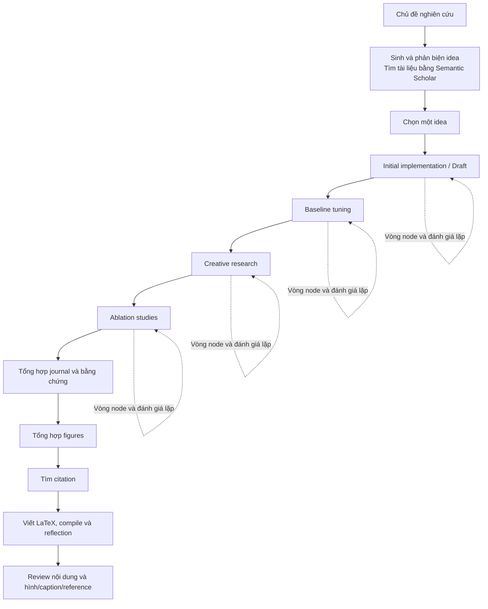

# MVP5: đối chiếu autoresearch gốc và Workbench

Ngày đối chiếu: **12/10/2026**, Asia/Saigon.

Nguồn chuẩn: `SakanaAI/AI-Scientist-v2`, nhánh `main`, commit
`96bd51617cfdbb494a9fc283af00fe090edfae48` ngày 19/12/2025. Đã fetch upstream
và đọc đúng snapshot này, đối chiếu với source Workbench đang chạy. Đây là kết
quả đọc code và tài liệu; không phải một lần chạy thí nghiệm mới.

## Cập nhật sau triển khai

Đã nối literature/novelty trước proposal, citation gathering dùng hàm upstream,
VLM trên ảnh node và figures, VLM trong reflection LaTeX và final PDF review.
Project Workflow đã có Hybrid/Full agent, actor/preset riêng, giới hạn vòng và
lưu Semantic Scholar API key một lần. Bằng chứng và trạng thái được lưu cùng
project/run. Chi tiết sử dụng ở `n8n/README.md`.

Cập nhật 13/10/2026: đã thêm generation/archive/selection theo project;
experiment manager có cấu hình worker và scaling trên UI; từng main stage và
bước hậu xử lý có operation/webhook riêng trên n8n. Các nhánh song song dùng
cùng notebook với thư mục, shell và RuntimeWorker riêng. Summary, plots, citation,
VLM, PDF và review đã có trên Workbench; không phải các cấu hình còn thiếu.

Các phần đối chiếu bên dưới giữ lại snapshot lịch sử trước những thay đổi này.
Thuật toán lựa chọn node/substage, thực thi và xác minh bằng chứng vẫn là domain
operations Python; n8n điều phối thời điểm bắt đầu và hoàn tất từng phase.

## 1. Kết luận về bản hiện tại

Khung ngoài đang là goal → human idea → agent proposal → human duyệt proposal
→ human duyệt run → Working → thu kết quả. Điều này giữ cách vận hành của các
MVP trước và khóa mất lựa chọn actor mà MVP5 đã yêu cầu.

Các điểm khóa nằm trong `ai_scientist/workbench/n8n_workflows.py`:

- `PHASES` chỉ có `ideation/proposal/approval/run_approval/execution/collect`.
- `create()` bắt ideation và approval là human, bắt `require_run_approval=True`.
- Các stage còn lại bị bắt là agent; `allow_agent_approval` bị ghi thành false.

UI `workbench-ui/src/projectWorkflows.ts` mặc định tắt experiment manager,
tắt multi-seed, summary, report, plots, writeup và review. UI cho chọn preset
nhưng không cho thay Human/Agent hay điểm chờ duyệt.

Workbench đã có phần tích hợp nghiên cứu gốc: `TreeSearchRun` dùng `AgentManager`
và `RemoteSearchAgent`, còn `ResearchPipeline` xử lý đầu ra. Vì vậy không thể
gọi toàn bộ backend là MVP3. Vấn đề là lớp điều phối/UI đang thu hẹp khả năng
đó và canvas n8n giấu quá trình nghiên cứu trong execution/collect.

Tài liệu `MVP5_STAGE_AUTONOMY.md` và mục MVP5 của `PRODUCT_ROADMAP.md` đã ghi
Human/Agent cho từng stage, hybrid, full auto có grant hữu hạn, pause/takeover.
`MVP5_STAGE_QA_RESULTS.md` còn ghi nghiệm thu lịch sử có approval agent và bốn
stage nghiên cứu. Các ràng buộc mới của n8n là một bước lùi so với yêu cầu ấy.

## 2. Luồng thực tế trong repo gốc

Multi-seed evaluation và tổng hợp plot của node được manager gọi khi hoàn
thành stage đủ điều kiện, trước khi chuyển sang stage kế tiếp. Sơ đồ trên
rút gọn phần này; không có nghĩa seed chỉ chạy một lần sau Ablation.

### Ideation và lựa chọn idea

`perform_ideation_temp_free.py` là một chương trình riêng. Nó đọc chủ đề Markdown,
đưa các idea đã có vào context, lặp generation/reflection, cho model gọi
`SearchSemanticScholar` hoặc `FinalizeIdea`, rồi lưu danh sách idea JSON.
Prompt yêu cầu tìm tài liệu trước khi chốt idea; code không có một phép kiểm
novelty độc lập bảo đảm yêu cầu đó được thực hiện.

Idea có Name, Title, Short Hypothesis, Related Work, Abstract, Experiments và
Risk Factors and Limitations. Đây là representation nghiên cứu phong phú hơn
form title/text và proposal thực thi của Workbench.

`launch_scientist_bfts.py` đọc danh sách và chọn **một** idea bằng `--idea_idx`
(mặc định 0), lưu `idea.json`, `idea.md` và config của attempt. Việc chọn idea
là input CLI; repo không có GUI lựa chọn Human/Agent ở bước này. Khi đã launch,
thí nghiệm và viết bài vận hành tự động, không có các cửa duyệt human xen giữa.

Nguồn: [Ideation](https://github.com/SakanaAI/AI-Scientist-v2/blob/96bd51617cfdbb494a9fc283af00fe090edfae48/ai_scientist/perform_ideation_temp_free.py),
[Launcher](https://github.com/SakanaAI/AI-Scientist-v2/blob/96bd51617cfdbb494a9fc283af00fe090edfae48/launch_scientist_bfts.py).

### Bốn stage nghiên cứu

| Stage gốc | Mục tiêu và cách kế thừa |
| --- | --- |
| Initial implementation / Draft | Tìm một implementation hoạt động để kiểm tra giả thuyết; có thể tạo nhiều bản draft và debug. Code ban đầu là tùy chọn. |
| Baseline tuning | Điều chỉnh hyperparameter của baseline, giữ kiến trúc; dùng implementation tốt từ Draft. Goal gốc còn yêu cầu thêm dataset để kiểm tra. |
| Creative research | Thử cải tiến phương pháp và ý tưởng có giá trị nghiên cứu, so với baseline đã tune; khai thác và mở rộng các nhánh tốt. |
| Ablation studies | Thay/bỏ từng thành phần của giải pháp nghiên cứu, đo đóng góp và đối chiếu cùng dữ liệu. |

`AgentManager.run()` có vòng main stage, substage và vòng step. Nó đánh giá
kết quả, có thể sinh mục tiêu substage mới, và chuyển implementation tốt sang
stage tiếp theo. Việc hoàn thành dựa vào implementation hợp lệ, feedback và
giới hạn iteration; hết iteration không bảo đảm chất lượng nghiên cứu.

`ParallelAgent` chọn node để draft/debug/improve. Stage tuning sinh ý tưởng
hyperparameter; stage ablation sinh ý tưởng loại bỏ/thay đổi thành phần. Worker
sinh code, chạy code, phân tích lỗi, sinh/chạy code trích metric từ dữ liệu,
sinh/chạy plotting và đọc plots bằng VLM. Journal lưu cả nhánh tốt và nhánh lỗi.
Chọn best node có thể dùng LLM và bằng chứng, không chỉ một phép max metric.

Config gốc hiện có 4 workers, 3 seeds, giới hạn stage 20/12/12/18 và timeout
3600 giây cho thực thi. Đây là giá trị config, không phải số thí nghiệm hoặc
mức compute bảo đảm. Nhánh debug còn có probability và giới hạn độ sâu.

Nguồn: [Manager](https://github.com/SakanaAI/AI-Scientist-v2/blob/96bd51617cfdbb494a9fc283af00fe090edfae48/ai_scientist/treesearch/agent_manager.py),
[Node workers](https://github.com/SakanaAI/AI-Scientist-v2/blob/96bd51617cfdbb494a9fc283af00fe090edfae48/ai_scientist/treesearch/parallel_agent.py),
[Journal](https://github.com/SakanaAI/AI-Scientist-v2/blob/96bd51617cfdbb494a9fc283af00fe090edfae48/ai_scientist/treesearch/journal.py),
[Config](https://github.com/SakanaAI/AI-Scientist-v2/blob/96bd51617cfdbb494a9fc283af00fe090edfae48/bfts_config.yaml).

### Từ bằng chứng tới paper

Sau manager, `perform_experiments_bfts()` lưu state/journals, visualization và
bốn summary JSON cho Draft, Baseline, Research, Ablation khi bật generate_report.
Trong entry point này, tên generate_report không đồng nghĩa tạo report.md:
`journal2report` được import nhưng không được gọi.

Launcher tiếp tục aggregate plots để tạo figures, rồi gather citations bằng
Semantic Scholar trước writeup. Writeup có bản ICBINB 4 trang hoặc normal 8
trang, compile LaTeX và reflection có feedback nội dung/hình. Sau đó review
paper bằng LLM và review hình/caption/reference bằng VLM, lưu các review.
Skip final review không nhất thiết bỏ feedback nội bộ trong writeup reflection.

Các đầu ra gồm idea/config, cây và journal thí nghiệm, code/log/metric, dữ liệu
plot, stage summaries, figures, LaTeX/PDF, review và token tracking.
Không thấy một vòng ở launcher tự đưa final paper review trở lại chọn idea
hoặc chạy lại toàn bộ research. Nếu Workbench muốn vòng đó, đó là phần mở rộng.

Nguồn: [Experiment runner](https://github.com/SakanaAI/AI-Scientist-v2/blob/96bd51617cfdbb494a9fc283af00fe090edfae48/ai_scientist/treesearch/perform_experiments_bfts_with_agentmanager.py),
[Plotting](https://github.com/SakanaAI/AI-Scientist-v2/blob/96bd51617cfdbb494a9fc283af00fe090edfae48/ai_scientist/perform_plotting.py),
[Citation và writeup](https://github.com/SakanaAI/AI-Scientist-v2/blob/96bd51617cfdbb494a9fc283af00fe090edfae48/ai_scientist/perform_icbinb_writeup.py),
[Text review](https://github.com/SakanaAI/AI-Scientist-v2/blob/96bd51617cfdbb494a9fc283af00fe090edfae48/ai_scientist/perform_llm_review.py),
[Visual review](https://github.com/SakanaAI/AI-Scientist-v2/blob/96bd51617cfdbb494a9fc283af00fe090edfae48/ai_scientist/perform_vlm_review.py).

## 3. Những phần Workbench đã tái sử dụng và đang thiếu

| Thành phần | Workbench hiện tại |
| --- | --- |
| Ideation + literature/novelty | Input title/text theo goal; chưa port vòng công cụ Semantic Scholar của upstream. |
| Structured research idea | Có adapter sang task description, nhưng form hiện tại chưa thể hiện đủ hypothesis/related work/experiments/risks của idea gốc. |
| Bốn stage + node search | Có AgentManager, search policy, journal, hyperparameter/ablation ideas; đang chạy trong Working/Python và tùy chọn search. |
| VLM feedback từng node | `vlm_feedback_summary` đang nhận summary/limitations từ payload; chưa có bước phân tích hình bằng VLM như worker upstream. |
| Compute | Một SSH/Kaggle session và một worker; không chạy GPU process pool gốc. |
| Dataset/evaluation | Giữ benchmark và dữ liệu được cấp, dùng stage goals đã điều chỉnh; không tự thêm dataset như goal gốc. |
| Multi-seed | Có adapter và seed protocol, chỉ chạy khi được cấu hình; UI mặc định seeds rỗng. |
| Summary/report/plots | Có ResearchPipeline, có tái sử dụng các module gốc; UI mặc định đều tắt. |
| Citation gathering | Writeup hiện dùng Library references và bỏ citation ví dụ; chưa gọi gather_citations/novelty search gốc. |
| Paper reflection | Có compile/revise dựa trên compiler log; source ghi rõ chưa visual review. |
| Review | Có text review bằng perform_review; chưa nối final VLM image/caption/reference review. |
| Hybrid/full agent | Data model có actor/ask/delegated approval, nhưng n8n create và UI hiện khóa hybrid cố định. |
| n8n canvas | Sáu bước admission/collect và vòng provider/action. Chưa có các bước nghiên cứu, chọn node, chuyển stage, seed, citation, manuscript/reflection trên canvas. |

Các adapter/sửa lỗi trước đây của Workbench vẫn có giá trị: stage budget đếm
node được sinh, checkpoint bền vững, sửa stage numbering, giới hạn compute,
metric kiểm từ artifact và thu kết quả qua Kaggle. Khôi phục autoresearch không
cần xóa những điều chỉnh này. Cần ghi rõ đâu là hành vi upstream, đâu là thích
nghi với benchmark, compute và grant của Workbench.

## 4. Hướng sửa MVP5 theo yêu cầu hiện tại

Đây là hướng triển khai rút ra từ audit, chưa phải thay đổi runtime đã làm.

Một blueprint nghiên cứu trong từng project phải thể hiện: ideation/literature
→ lựa chọn idea → thí nghiệm bốn stage và các vòng node → đánh giá seed/tổng hợp
→ figures → citations → manuscript/reflection → peer review → kết quả.

Thiết lập actor và điểm duyệt là hai quyết định riêng:

- **Human/Agent:** ai tạo hoặc quyết định đầu ra của stage.
- **Điểm duyệt:** có chờ human xem candidate trước khi chuyển tiếp hay không.
- **Preset:** agent/model sử dụng cho bước có actor Agent; các vai trò code,
  feedback, vision, selection, summary, citation, writing, review phải được
  đối chiếu và ánh xạ rõ.

**Hybrid** cho user chọn các stage/điểm duyệt cần tham gia, ví dụ chọn idea,
duyệt thiết kế, chọn nhánh hoặc xem plots/paper. **Full agent** để agent xử lý
các quyết định nghiên cứu trong grant đã lưu, gồm phê duyệt proposal/run được
ủy quyền; không ép human nhập idea và duyệt lại mỗi lượt. Grant ban đầu ghi
project, dữ liệu, account, compute, số node/lượt agent và đầu ra; receipt ghi
đúng actor. Pause/takeover phải giữ bằng chứng và vô hiệu hóa actor cũ.

Full agent và hybrid là cấu hình actor/review trên cùng blueprint, không cần
khôi phục các template Team hoặc coding topology cũ.

Trên n8n, vòng **provider → action** và vòng **research → evidence → chọn nhánh
→ chuyển stage** phải có vai trò và trạng thái riêng. Canvas cần mở được tiến
độ thí nghiệm thực, các nhánh debug/improve, node được chọn, seed và artifacts.
Gọi một HTTP execution rồi đợi collect chưa đáp ứng yêu cầu trực quan ấy.

Python tiếp tục cung cấp domain operations cho journal, selection, metric,
Kaggle và output; n8n điều phối các operations có ranh giới rõ. Ưu tiên mở các
điểm đã có trong manager và finishing pipeline, giữ hành vi đã kiểm chứng rồi
thay điều phối. Không chạy nguyên block main của launcher: phần cleanup cuối
file có thao tác tìm/terminate process theo keyword toàn hệ thống, không phù
hợp để gọi trực tiếp từ Workbench trên máy người dùng.

## 5. Điều kiện đánh giá bản n8n sửa tiếp theo

1. Hybrid và full agent chọn được trên UI và được backend thực hiện đúng.
2. Full agent đi qua các stage đã yêu cầu trong grant, không bị các khóa human
   hiện tại ép dừng; hybrid dừng đúng những điểm user chọn.
3. Cây thí nghiệm có nhánh, debug/improve/tuning/ablation và quyết định chuyển
   stage theo bằng chứng; các node đọc cùng protocol đánh giá đã cấp.
4. Multi-seed, literature/citation, vision feedback, plots, paper và review có
   trạng thái/đầu ra riêng. Khả năng thiếu phải báo rõ, không gọi text summary
   là visual review.
5. N8n execution liên kết được với project, stage, node và artifacts thực.
6. Pause/takeover/restart giữ những phần đã xong và không tự chạy lại công việc
   có kết quả chưa xác định. Một session/experiment node/workflow cần được đặt
   tên và đếm riêng để budget và human review có nghĩa rõ ràng.

Tài liệu liên quan: [MVP5 stage autonomy](MVP5_STAGE_AUTONOMY.md),
[Roadmap](PRODUCT_ROADMAP.md), [QA lịch sử](MVP5_STAGE_QA_RESULTS.md).
